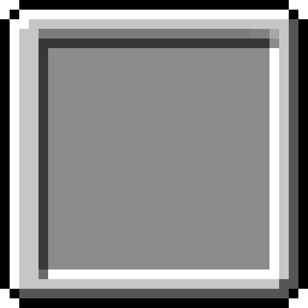

<!-- PROJECT BADGES -->
<div align="center">

[![Packagist][packagist-badge]][packagist-url]
[![CI][ci-badge]][ci-url]
[![Stars][stars-badge]][stars-url]
[![License][license-badge]][license-url]

</div>


<!-- PROJECT LOGO -->
<br />
<div align="center">
  
  <h3>libcontainer</h3>
  <p align="center">
    Virtual inventory menus for axolotl-pm/PocketMine-MP: buttons, locked slots and live inventory views, without placing blocks.

[Packagist][packagist-url] · [Changelog](CHANGELOG.md) · [Report a bug][issues-url] · [Request a feature][issues-url]

  </p>
</div>

```php
$menu = Menu::chest("Shop")->setButton(13, VanillaItems::DIAMOND(), fn(Click $c) => $c->player->sendMessage("Bought!"));
$menu->open($player);
```

-----

## 🌟 Why libcontainer?

A menu is an inventory window that is not backed by a real chest. libcontainer shows it as the inventory of an
**invisible entity that only the viewer receives** (an `AddActorPacket` with container metadata), so no block is
placed, no chunk is touched, and nothing is left behind when the player disconnects.

- **No blocks, no world changes** : nothing to restore after a crash
- **Safe by default** : every slot is locked until you unlock it, so an unfinished menu cannot leak items
- **Buttons, free slots and views** : one slot rule model for shops, selectors, dustbins and inventory viewers
- **Any size** : 27, 54 or 243 slots, or your own `ContainerType`
- **Testable** : the click and slot decisions are plain classes with unit tests that need no server

-----

## 📦 Installation

```sh
composer require presentkim/libcontainer
```

| Requirement | Version                                                          |
|-------------|------------------------------------------------------------------|
| Server      | [axolotl-pm/PocketMine-MP][axolotl-url] 5.51 or newer (fork of PocketMine-MP 5) |
| PHP         | **8.4** or newer                                                 |

> Using it in a plugin: plugins built from [presentkim-pm/plugin-template][plugin-template-url] bundle Composer
> libraries into the phar with shaded namespaces at release, so `composer require` is all a plugin needs.

Register once, usually in `onEnable()`:

```php
use kim\present\libcontainer\LibContainer;

protected function onEnable() : void{
    LibContainer::register($this);
}
```

> **The default entity type is provisional.** `ContainerType::DEFAULT_ENTITY_TYPE` (`minecraft:chest_minecart`) and the
> position of the entity are waiting for in-game measurement and may change before 1.0. Types you build yourself with
> `->entityType()` are never affected.

-----

## 🚀 Examples

<details open>
<summary><b>Button menu</b></summary>

```php
use kim\present\libcontainer\Click;
use kim\present\libcontainer\Menu;

$menu = Menu::chest("Server selector");
$menu->setButton(11, VanillaItems::COMPASS()->setCustomName("Survival"), function(Click $click) : void{
    $click->menu->closeThen($click->player, fn() => $this->teleportToSurvival($click->player));
});
$menu->setButton(15, VanillaItems::BED()->setCustomName("Lobby"), fn(Click $click) => $this->sendToLobby($click->player));
$menu->open($player);
```

A click on a button is always cancelled, so the item never moves. The callback runs on the **next tick**, never inside the
transaction event, so closing the menu or opening another one is safe. `$click->clickType` tells a normal click
(`PICKUP`) from shift-click (`QUICK_MOVE`), drop (`DROP`) and replacing the cursor item (`SWAP`).

</details>

<details>
<summary><b>Free slots: a dustbin</b></summary>

```php
$bin = Menu::chest("Dustbin")->unlockAll();
$bin->onClose(fn(Player $player, Menu $menu) => $menu->clear()); // everything put in is gone

// only allow some items, in a single slot
$slot = Menu::chest("Offering")->accept(13, fn(Item $item) : bool => $item->equals(VanillaItems::GOLD_INGOT(), true, false));

// veto or log individual changes
$slot->onChange(function(SlotChange $change) : bool{
    return $change->after->getCount() <= 16; // false cancels the change
});
```

`lock(int ...$slots)` and `unlock(int ...$slots)` change single slots; `lockAll()` is the default.

</details>

<details>
<summary><b>Bound inventory: an inventory viewer</b></summary>

```php
$menu = Menu::large($target->getName() . "'s inventory");
$menu->bind($target->getInventory());              // slots 0..35, two-way and live
$menu->bind($target->getArmorInventory(), 45);     // slots 45..48
$menu->open($admin);

// stop mirroring when you are done
$menu->onClose(fn() => $menu->unbind($target->getInventory()));
```

Changes the admin makes are written to the target's inventory, and changes to the target's inventory (picking up an
item, for example) show up in the menu. Bound slots are free slots.

</details>

<details>
<summary><b>Custom container types</b></summary>

```php
use kim\present\libcontainer\ContainerType;
use kim\present\libcontainer\ContainerTypes;
use pocketmine\network\mcpe\protocol\types\inventory\WindowTypes;

ContainerTypes::register("myplugin:hopper", ContainerType::builder()
    ->size(5)
    ->windowType(WindowTypes::HOPPER)
    ->build());

$menu = Menu::create("myplugin:hopper", "Pick one");
```

Built-in ids: `ContainerTypes::CHEST` (27 slots), `LARGE` (54) and `FULL` (243). Registering an id twice throws.
For a different way of showing the window, implement `ContainerDisplay` and pass it with `->display()`.

</details>

<details>
<summary><b>Resource-pack screens</b></summary>

```php
ContainerTypes::register("myplugin:shop", ContainerType::builder()
    ->size(54)
    ->screenKey("§b§w§s§h") // prepended to the title the client receives
    ->build());
```

The client receives `screenKey + title` as the window title, so a resource pack's JSON UI can recognise the prefix
and draw its own screen. Your plugin only sees the plain title.

</details>

-----

## 📖 API reference

All classes are in `kim\present\libcontainer`.

| Class / method                                           | Description                                                                 |
|----------------------------------------------------------|-----------------------------------------------------------------------------|
| `LibContainer::register(PluginBase $plugin)`             | Register the listener and hook every player. Idempotent                      |
| `LibContainer::isRegistered()`                           | Whether a registering plugin is enabled                                      |
| `Menu::create(string\|ContainerType $type, string $title = "")` | Create a menu; `chest()`, `large()`, `full()` are shortcuts                  |
| `getInventory()`, `getType()`, `getTitle()`, `getViewers()` | Read state                                                                |
| `setTitle(string)`                                       | Rename; viewers get the window re-opened                                     |
| `setItem()`, `getItem()`, `setContents()`, `clear()`     | Contents                                                                     |
| `setButton(int $slot, Item $item, \Closure(Click) : void)` | Put an item in the slot and make it a button                                |
| `removeButton(int $slot)`                                | Remove the callback (the item stays)                                         |
| `lockAll()`, `unlockAll()`, `lock(int ...)`, `unlock(int ...)` | Slot rules, all locked by default                                      |
| `accept(int $slot, \Closure(Item) : bool)`               | Free slot that only accepts validated items                                  |
| `onChange(\Closure(SlotChange) : bool)`                  | Veto changes to free slots                                                   |
| `onOpen(\Closure(Player))`, `onClose(\Closure(Player, Menu))` | Open and close handlers                                                |
| `bind(Inventory $source, int $offset = 0)`, `unbind()`   | Mirror an inventory into a slot range                                        |
| `open(Player) : bool`, `close(Player)`                   | Show and hide                                                                |
| `closeThen(Player, \Closure)`                            | Close, then run after the client acknowledged                                |
| `ContainerType::builder()`                               | `size()`, `windowType()`, `entityType()`, `screenKey()`, `display()`, `build()` |
| `ContainerTypes::register()`, `get()`, `has()`, `all()`  | Registry of named types                                                      |

### How a click is handled

One listener watches `InventoryTransactionEvent` (priority `HIGH`) and looks at the menu slots the transaction touches:

1. Any **button**: the event is cancelled and each touched button's callback runs once, on the next tick.
2. Else any **locked** slot: the event is cancelled.
3. Else (**free** slots only): validators from `accept()` run, then the `onChange()` handlers. A `false` cancels the event.

Windows are cleaned up when they close, when the player quits, dies or teleports. `onOpen` / `onClose` are not called again when `setTitle()` re-opens the window.

-----

## 🧪 Development

```sh
composer install --ignore-platform-req='ext-*'
composer test
```

The server's native extensions are not needed for the tests. The decisions about clicks live in
`kim\present\libcontainer\logic` as plain classes without server types, which is why they are covered by unit tests,
while opening menus needs a real server and is not.

-----

## 📄 License

Distributed under the **MIT** License. See [LICENSE][license-url] for more information.


[packagist-badge]: https://img.shields.io/packagist/v/presentkim/libcontainer.svg?style=for-the-badge

[packagist-url]: https://packagist.org/packages/presentkim/libcontainer

[ci-badge]: https://img.shields.io/github/actions/workflow/status/presentkim-pm/libcontainer/ci.yml?branch=main&style=for-the-badge

[ci-url]: https://github.com/presentkim-pm/libcontainer/actions/workflows/ci.yml

[stars-badge]: https://img.shields.io/github/stars/presentkim-pm/libcontainer.svg?style=for-the-badge

[license-badge]: https://img.shields.io/github/license/presentkim-pm/libcontainer.svg?style=for-the-badge

[stars-url]: https://github.com/presentkim-pm/libcontainer/stargazers

[issues-url]: https://github.com/presentkim-pm/libcontainer/issues

[license-url]: https://github.com/presentkim-pm/libcontainer/blob/main/LICENSE

[axolotl-url]: https://github.com/axolotl-pm/PocketMine-MP

[plugin-template-url]: https://github.com/presentkim-pm/plugin-template
